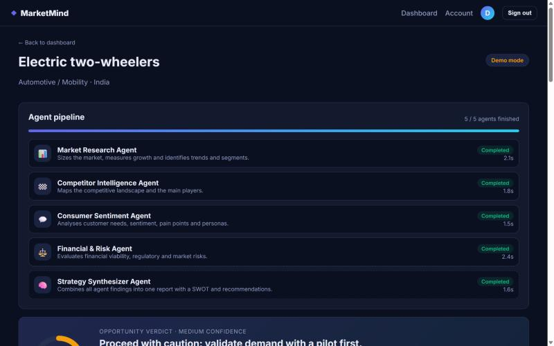

# MarketMind: AI-Powered Multi-Agent Market Research

MarketMind is a full-stack web application where a **team of AI agents** researches a market for you.
You describe a market question once; four specialist agents study it **in parallel**, and a fifth
agent combines their findings into one decision-ready report with a score, SWOT analysis, charts and
recommendations. Users, login sessions, sign-in history and every report are stored in a database.



## The agents

| # | Agent | What it produces |
|---|-------|------------------|
| 1 | Market Research Agent | Market size, growth rate, key trends, customer segments |
| 2 | Competitor Intelligence Agent | Competitors, positioning, strengths, weaknesses, white space |
| 3 | Consumer Sentiment Agent | Sentiment score, purchase drivers, pain points, personas |
| 4 | Financial & Risk Agent | Outlook, risk register with mitigations, opportunities |
| 5 | Strategy Synthesizer Agent | Reads agents 1-4 and writes SWOT, score, verdict, recommendations |

Agents 1-4 run concurrently (`Promise.all`); agent 5 runs once they finish. Every agent's output
is saved to the `agent_runs` table, so the UI can show live progress.

## Architecture

```
React (Vite) frontend  ──HTTPS + JWT──▶  Express API  ──SQL──▶  SQLite database
                                            │
                                            ▼
                                  Agent orchestrator ──▶ Claude API (or offline demo engine)
```

| Layer | Technology |
|-------|-----------|
| Frontend | React 18, Vite, React Router, Recharts |
| Backend | Node.js (22.13+), Express, Helmet, CORS, express-rate-limit |
| Database | SQLite through Node's built-in `node:sqlite` (no database server needed) |
| Auth | bcrypt password hashing, JWT, server-side sessions table, login history |
| AI | Anthropic Claude via the official `@anthropic-ai/sdk`, JSON-schema structured outputs |

## Project structure

```
marketmind/
├── backend/                 Express REST API
│   └── src/
│       ├── server.js        App entry point
│       ├── db.js            SQLite connection (applies database/schema.sql)
│       ├── middleware/      JWT + session check
│       ├── routes/          auth.js, analyses.js
│       └── agents/          definitions.js, orchestrator.js, llm.js (Claude), demo.js (offline)
├── frontend/                React app
│   └── src/pages/           Landing, Login/Register, Dashboard, Report, Account
├── database/schema.sql      Tables: users, sessions, login_history, analyses, agent_runs
└── docs/                    Presentation (.pptx), its generator script, screenshots
```

## Getting started

Requires **Node.js 22.13 or newer**.

```bash
npm install
npm run install:all
cp backend/.env.example backend/.env
npm run dev
```

Open http://localhost:5173, create an account and run an analysis.

### AI mode vs demo mode

- **Demo mode (default):** with `ANTHROPIC_API_KEY` empty, the agents produce realistic sample output
  offline, so the whole system works without any key. Good for presentations.
- **Live AI mode:** set `ANTHROPIC_API_KEY` in `backend/.env`. Each agent is then a real Claude call
  (model set by `CLAUDE_MODEL`, default `claude-opus-5-5`) that returns JSON matching the agent's schema.

### Production build

```bash
npm run build
npm start
```

The API then also serves the built frontend on http://localhost:5000.

## Database and authentication

The schema lives in [`database/schema.sql`](database/schema.sql) and is applied automatically on startup.
The database file is created at `backend/data/marketmind.db`.

- `users`: name, unique email, **bcrypt password hash** (never plain text), role, last login
- `sessions`: one row per login; the JWT carries the session id, so logout revokes it instantly
- `login_history`: every sign-in attempt, successful or not, with time, IP and device
- `analyses`: each research request and its final report (JSON)
- `agent_runs`: each agent's status, output and run time

Login and register are rate limited, and users can only access their own analyses.

## API

| Method | Endpoint | Auth | Purpose |
|--------|----------|------|---------|
| POST | `/api/auth/register` | No | Create account, returns token |
| POST | `/api/auth/login` | No | Sign in (attempt is logged) |
| POST | `/api/auth/logout` | Yes | Revoke current session |
| GET | `/api/auth/me` | Yes | Profile and recent sign-ins |
| GET | `/api/analyses` | Yes | List my analyses and stats |
| POST | `/api/analyses` | Yes | Start a multi-agent analysis (202) |
| GET | `/api/analyses/:id` | Yes | Live agent status, outputs and report |
| DELETE | `/api/analyses/:id` | Yes | Delete an analysis |

## Presentation

[`docs/MarketMind-Presentation.pptx`](docs/MarketMind-Presentation.pptx) is a 16-slide deck with speaker notes.
To regenerate it: `npm install pptxgenjs && node docs/build-presentation.js`.
